# LedgerPulse — Visual Product & End-to-End Workflow

> A recruiter/interviewer-friendly walkthrough of the LedgerPulse product. This page puts the complete tested workflow and all curated screenshots in one place.

## What is LedgerPulse?

LedgerPulse is a full-stack financial operations application for managing a company's day-to-day finance workflow in one workspace.

The tested product flow covers:

**Public site → interactive demo → authenticated workspace → dashboard → invoices → payments → expenses → customers/vendors → recurring billing → reports → team/settings → notifications/admin → validation/security checks**

The important part is that these are not screenshots of disconnected pages. The screenshots come from real browser journeys where the React frontend talks to the Flask API, data is persisted in the backend database, and the workflow is verified with API assertions.

## Technology

| Layer | Technology |
|---|---|
| Frontend | React 19, TypeScript, Vite |
| UI | Tailwind CSS, Lucide React, Motion |
| Authentication integration | Firebase |
| Backend | Flask |
| Data layer | SQLAlchemy / Flask-SQLAlchemy |
| Database support | SQLite for disposable CI E2E runs, PostgreSQL support in the backend |
| PDF / exports | jsPDF + CSV exports |
| Browser testing | Playwright |
| CI | GitHub Actions |

## Product workflow

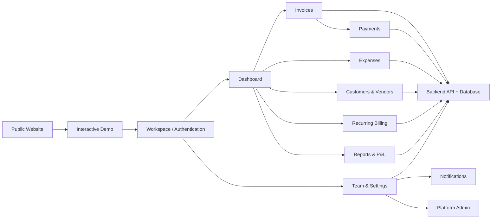

## What was actually verified

The final integrated browser run completed **9/9 journeys successfully**.

Those journeys verify:

- Public landing, pricing, FAQ/legal pages, contact failure handling and interactive demo/role switching.
- Authenticated bootstrap, sample-data loading and dashboard rendering.
- Invoice creation, editing, finalization, duplication, PDF download, deletion, filtering and CSV export.
- Payment recording, backend persistence, ledger filtering and CSV export.
- Expense creation, editing, deletion and pending → approved workflow.
- Customer and vendor creation, update and deletion.
- Recurring schedule creation and scheduled invoice generation.
- Financial reports, CSV export, team management, business settings, notifications and platform administration.
- Backend authorization, tenant isolation, invalid-request handling, financial validation and public API failure behavior.

## Visual evidence

Every screenshot below is generated only after the corresponding browser assertions pass.

### 01 — Public landing

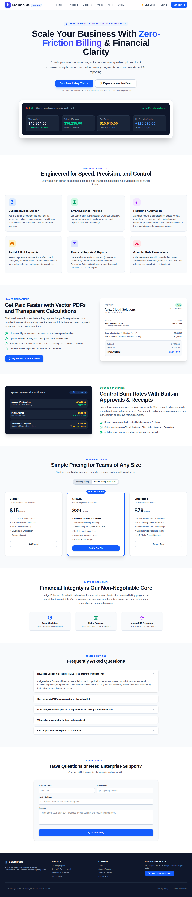

Shows the product's public entry point and the visual language used before authentication.

### 02 — Public contact error handling

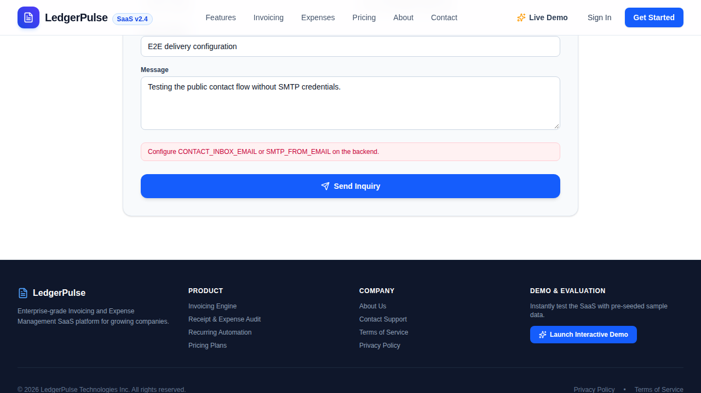

Shows how the public contact flow behaves when the backend cannot deliver the message.

### 03 — Interactive demo dashboard

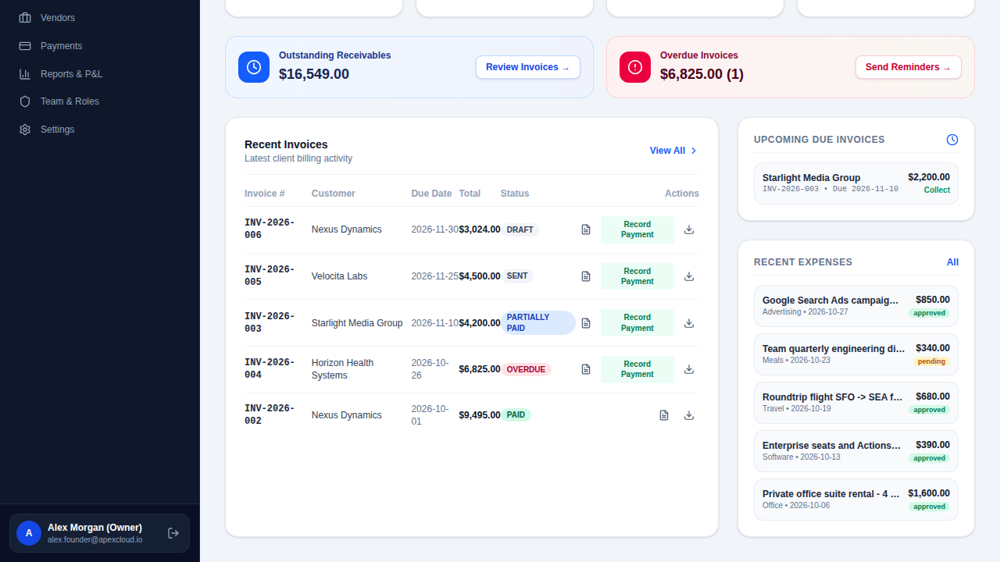

Shows the public demo experience and the transition into a realistic LedgerPulse workspace.

### 04 — Seeded executive dashboard

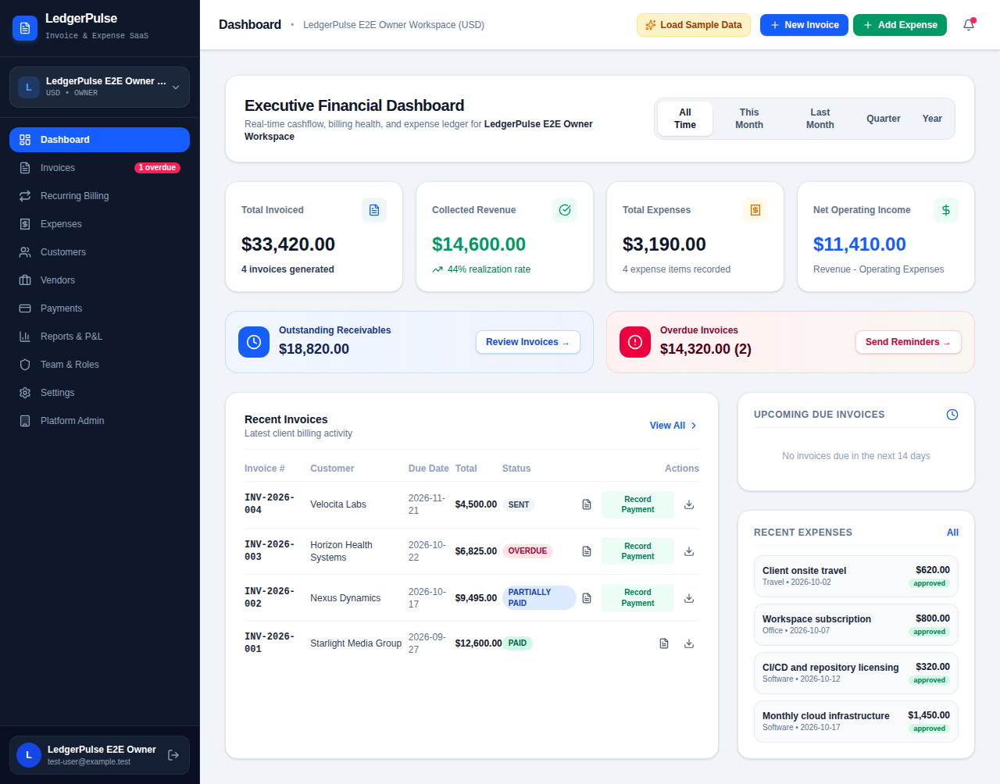

Shows the dashboard after real backend sample data is loaded and rendered through the application.

### 05 — Invoice management list

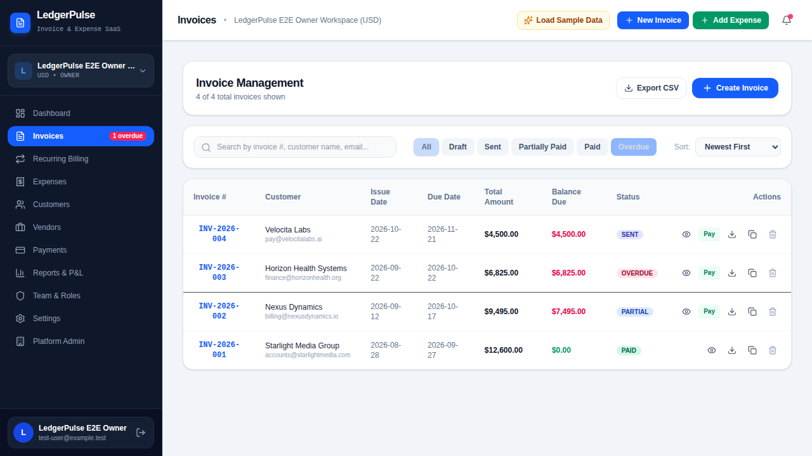

Shows invoice search/filtering and the financial document workflow entry point.

### 06 — Invoice lifecycle completed

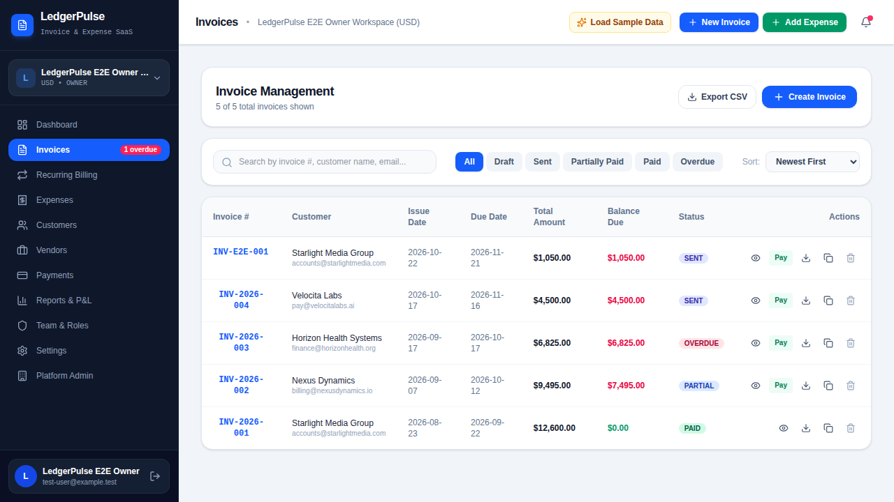

Shows the successful invoice workflow including creation, issue/finalization, duplication, PDF generation and cleanup.

### 07 — Payment ledger

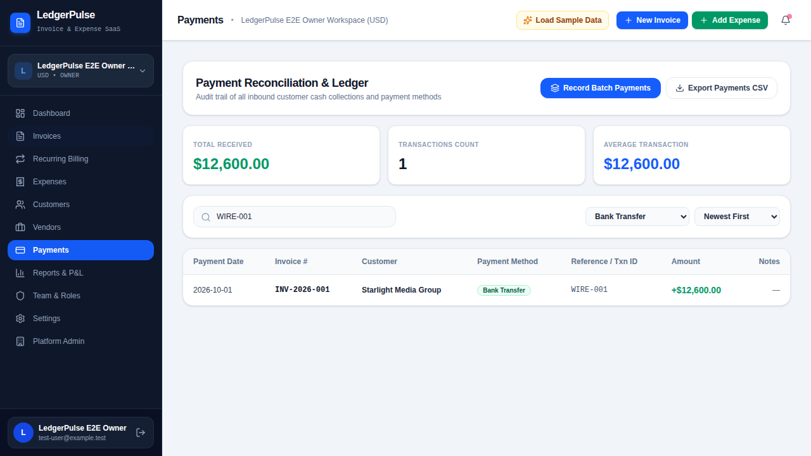

Shows payment reconciliation after a payment is recorded and persisted by the backend.

### 08 — Expense lifecycle

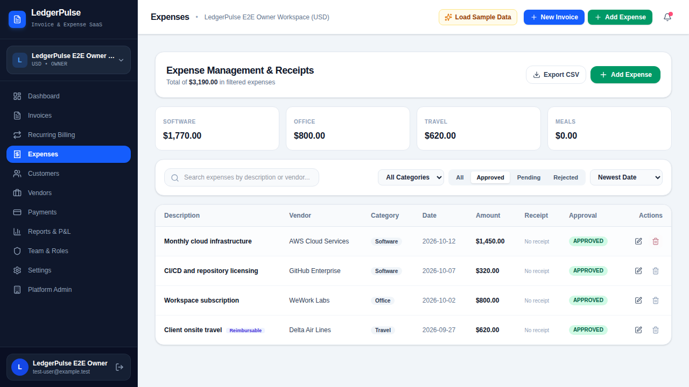

Shows expense creation/editing plus the approval workflow and final cleanup.

### 09 — Customers and vendors

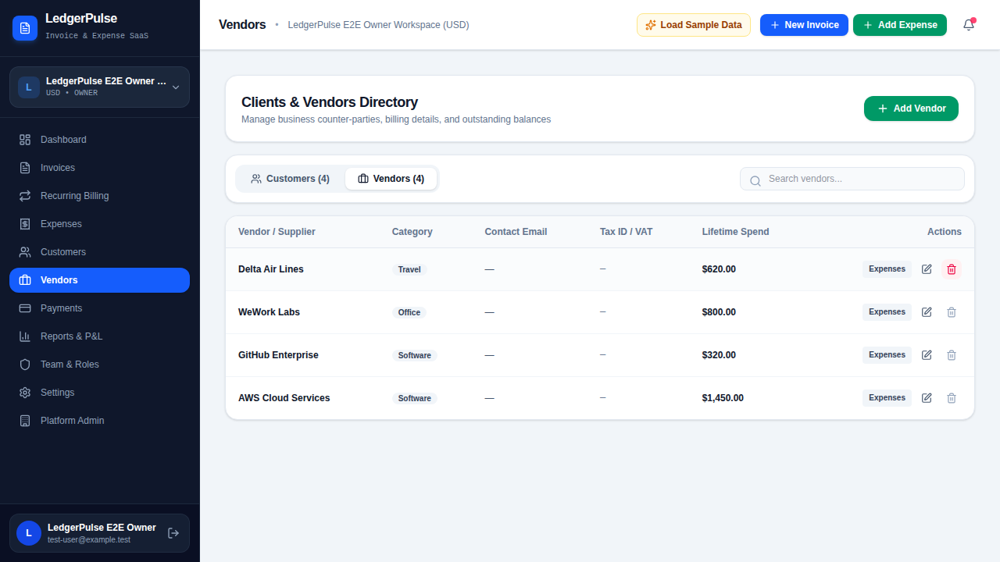

Shows the customer/vendor directory workflow with create, update and delete operations.

### 10 — Recurring billing

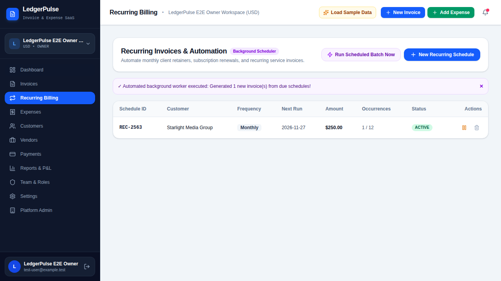

Shows recurring schedule creation and the automated scheduled-invoice generation flow.

### 11 — Financial reports

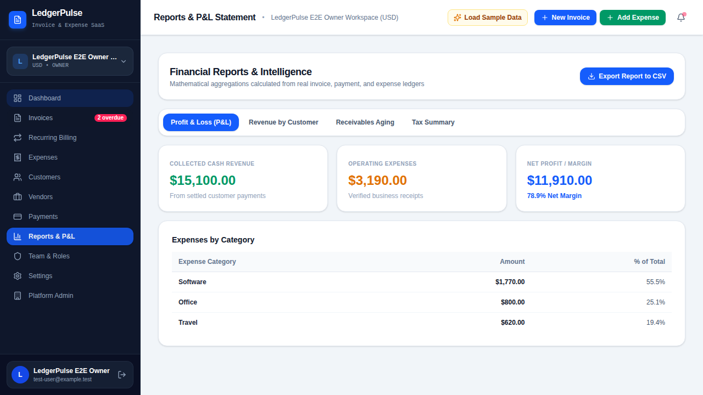

Shows the reporting workflow and report export capability.

### 12 — Team, settings and admin

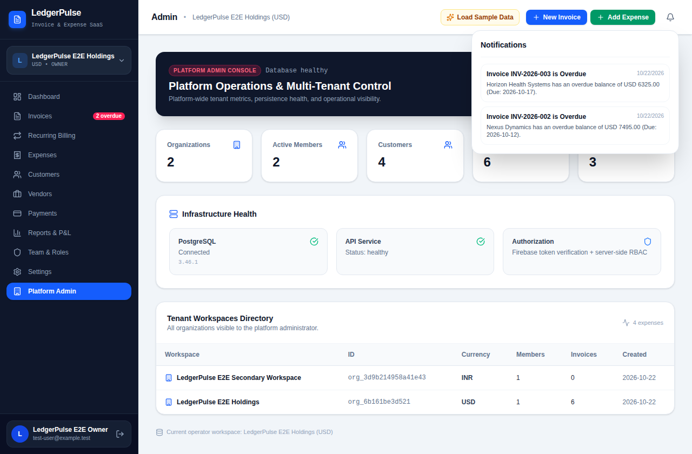

Shows organization/workspace management, team settings, business profile settings, notifications and platform administration.

### 13 — Final successful application state

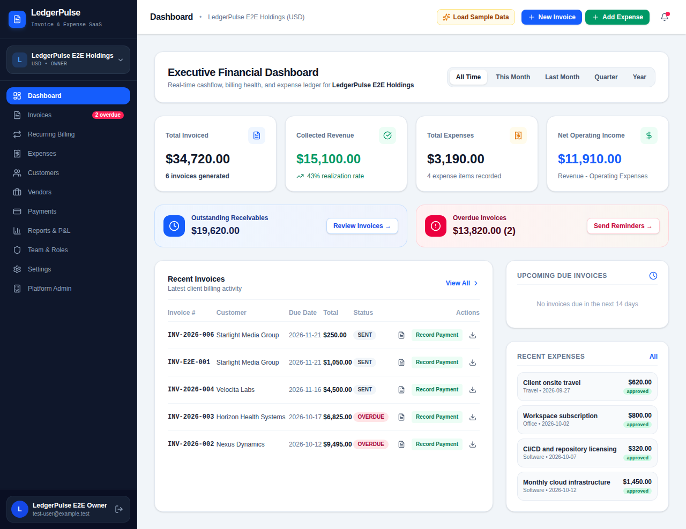

Final visual checkpoint from the completed integrated workflow.

## Why this matters in an interview

This evidence demonstrates more than UI implementation.

It shows that the project was exercised as a real product:

**UI action → API request → backend authorization → database persistence → UI state update → exported/visible result**

It also demonstrates attention to failure handling, multi-tenant boundaries, financial validation, role/permission behavior and automated browser verification rather than relying only on static screenshots.

## CI evidence

The final successful integrated run is available here:

- [LedgerPulse Frontend CI — Run #51](https://github.com/faizansaiyed123/ledgerpulse_frontend/actions/runs/39728978175)
- [Screenshot manifest](visuals/manifest.json)
- [E2E evidence artifact](https://github.com/faizansaiyed123/ledgerpulse_frontend/actions/runs/39728791921/artifacts/12403654926)

## Verification environment

**Browser:** Chromium controlled by Playwright  
**Viewport:** 1280 × 720  
**Backend:** Flask API using disposable SQLite for CI E2E runs  
**Authentication:** isolated CI test identity; production Firebase credentials are not used by the E2E suite

## Final verification

- Frontend build: ✅
- Frontend integrated E2E: ✅ 9/9
- Backend CI: ✅
- Curated screenshots: ✅ 13
- Visual walkthrough: ✅
- API persistence / authorization / tenant-isolation assertions: ✅
